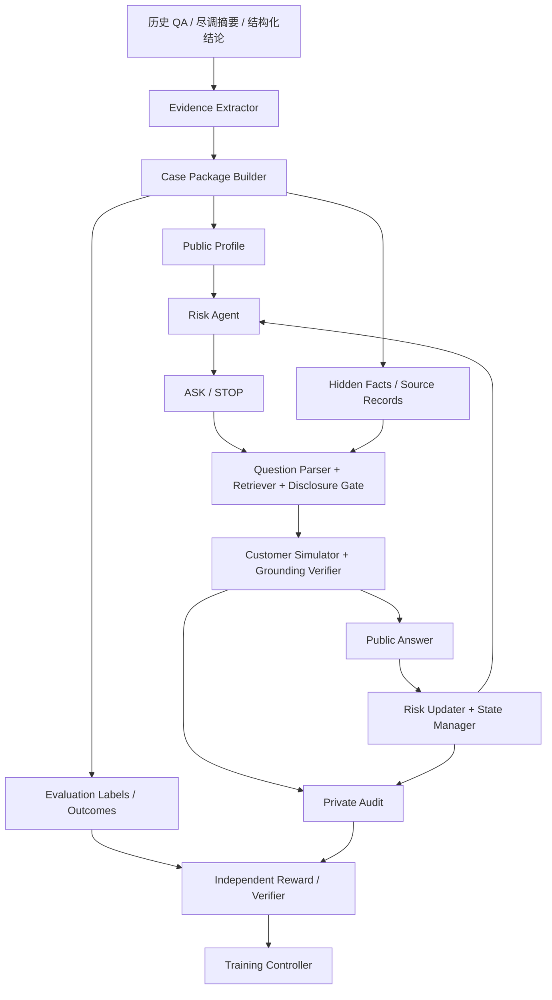

# 01 · 系统架构与信息边界

## 目标与主循环

Risk Agent 不具备完整客户真相。它根据初始客户画像形成假设，选择询问目标，从模拟客户获得有限新信息，更新风险账本，再选择 ASK 或 STOP。

## 组件责任与可见性

| 组件 | 职责 | 可读数据 | 禁止读取 |
|---|---|---|---|
| Evidence Extractor | 抽取原子声明、归属、来源和时间 | 历史原始材料 | 不得自行制造未在原文出现的金额 |
| Case Builder | 形成可训练 Case Package | 抽取结果、标签、分组元数据 | 不得把未来 outcome 放进公开画像 |
| Risk Agent | 风险分析、问题规划、状态更新 | Public Profile、已获得回答和 Risk Ledger | Hidden Facts、Evaluator labels、Reward Audit |
| Simulator | 回答 Agent 问题 | 当前问题与 DisclosurePlan 允许的陈述 | 直接读取 S4 风险结论或结果标签 |
| Disclosure Gate | 决定可披露的事实集合 | 问题意图、隐藏事实、历史披露集合 | 不根据 Agent 自报的 expected_fact_keys 直接放行 |
| State Manager | 校验事件、生成风险快照 | Agent 的变更提案及当前已公开证据 | 修改不可变的原始观测 |
| Verifier | 检查事实与奖励 | 隐藏评估证据、轨迹和私有 audit | 将隐藏标签返回 Agent |
| Trainer | 优化 Agent 策略 | Agent action tokens、reward、可见轨迹 | 将 Simulator 回答 Token 作为 Agent 动作优化 |

## 三层状态

- **Disclosure State**：`HIDDEN` / `MENTIONED` / `DISCLOSED`。主题可以仅被提到，具体 fact 仍未披露。已经披露的事实不会退回隐藏状态。
- **Epistemic/Evidence State**：`REPORTED` / `VERIFIED` / `CONTRADICTED` / `UNDETERMINED`。历史 QA 能证明“客户曾如此表示”，不能自动证明陈述为真。
- **Risk State**：风险假设、状态、严重度、支持/反驳证据、未解决问题。风险状态与风险严重度相互独立。

## 关键隔离

1. Agent 的公开 Observation 中不出现 `fact_id` 的隐藏候选列表、来源级别、参考风险标签或 reward 数值。
2. Simulator 的语言模型只接收 DisclosurePlan 中允许的声明，不读取完整 Eval 数据。
3. Verifier 的私有 Audit 仅供训练/评估服务读取；通过 ACL/服务分离实施，而不只依赖 Prompt。
4. 模拟器或 Verifier 的不可靠响应应被标记为环境失败，不能让训练器误把它当作策略负例。

## 时间语义

- `case.cutoff_at`：历史尽调的起始观察时点。
- `fact.valid_at`：陈述所指事实的业务适用时间。
- `fact.knowledge_available_at`：模拟客户最早合理知晓该内容的时间。
- `source.recorded_at`：来源实际形成时间，可晚于初始尽调时点（历史问答往往是在尽调中记录）。**不能仅凭 recorded_at 晚于 cutoff 就排除事实**；应判断内容当时客户是否已知，且绝不能借用其后发生的未来事实。
- `outcomes`：历史贷后结果仅供离线评价，不进入对话生成。
